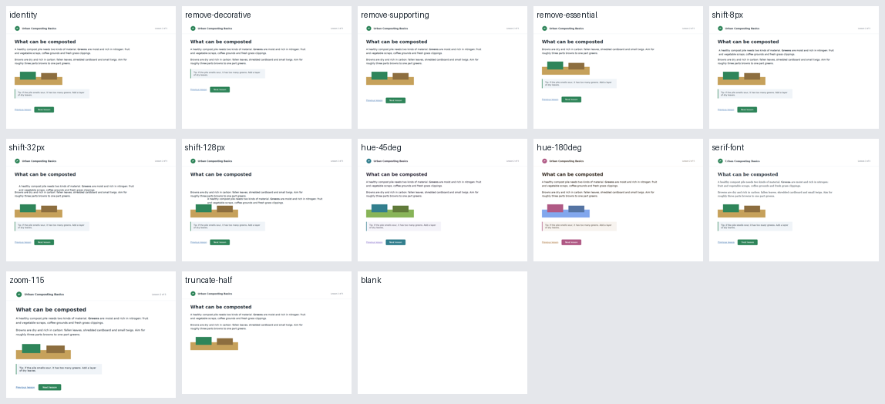

# Perturbation study

> Synthetic pages of a fictitious course. **Not results of the study.** Generated by
> `edufidelity perturbations`; every number below comes from `perturbations.csv`.

Pages: lesson, overview, quiz. Perturbations: 12 plus identity. UIClip checkpoint: `biglab/uiclip_jitteredwebsites-2-224-paraphrased_webpairs_humanpairs@505d473`.

## Mean over pages

| Perturbation | ssim | uiclip | ep_f1 | layout_fidelity | ped_essential | ped_supporting | ped_decorative |
|---|---:|---:|---:|---:|---:|---:|---:|
| identity | 1.000 | 1.000 | 1.000 | 1.000 | 1.000 | 1.000 | 1.000 |
| remove-decorative | **0.943** | **0.998** | **0.958** | **0.761** | 1.000 | 1.000 | **0.500** |
| remove-supporting | **0.960** | **0.983** | **0.958** | **0.644** | 1.000 | **0.786** | 1.000 |
| remove-essential | **0.934** | **0.994** | **0.958** | **0.579** | **0.808** | 1.000 | 1.000 |
| shift-8px | **0.977** | **0.999** | 1.000 | **0.965** | 1.000 | 1.000 | 1.000 |
| shift-32px | **0.972** | **0.996** | 1.000 | **0.926** | 1.000 | 1.000 | 1.000 |
| shift-128px | **0.969** | **0.995** | 1.000 | **0.919** | 1.000 | 1.000 | 1.000 |
| hue-45deg | **1.000** | **0.990** | 1.000 | 1.000 | 1.000 | 1.000 | 1.000 |
| hue-180deg | **0.999** | **0.981** | 1.000 | 1.000 | 1.000 | 1.000 | 1.000 |
| serif-font | **0.951** | **0.990** | 1.000 | **0.982** | 1.000 | 1.000 | 1.000 |
| zoom-115 | **0.831** | **0.978** | 1.000 | **0.139** | 1.000 | 1.000 | 1.000 |
| truncate-half | **0.983** | **0.995** | **0.876** | **1.000** | 0.808 | 0.738 | 0.833 |
| blank | **0.911** | **0.836** | **0.000** | **0.000** | **0.000** | **0.000** | **0.000** |

Bold: the measure is expected to fall for that perturbation (expectations are fixed in `perturbations.py` before running).

## Where a measure did not behave as expected

| Page | Perturbation | Measure | Expected | Identity | Value |
|---|---|---|---|---:|---:|
| lesson | truncate-half | layout_fidelity | drop | 1.000 | 1.000 |
| lesson | truncate-half | ped_essential | no drop | 1.000 | 0.750 |
| lesson | truncate-half | ped_supporting | no drop | 1.000 | 0.500 |
| quiz | truncate-half | layout_fidelity | drop | 1.000 | 1.000 |
| quiz | truncate-half | ped_essential | no drop | 1.000 | 0.875 |
| quiz | truncate-half | ped_decorative | no drop | 1.000 | 0.500 |
| overview | truncate-half | layout_fidelity | drop | 1.000 | 1.000 |
| overview | truncate-half | ped_essential | no drop | 1.000 | 0.800 |
| overview | truncate-half | ped_supporting | no drop | 1.000 | 0.714 |

243 of 252 checks as expected.

## Graded perturbations

A measure should not improve as the same defect gets stronger.

- lesson / shift / uiclip: not monotonic.
- quiz / shift / ssim: not monotonic.
- overview / recolor / ssim: not monotonic.
